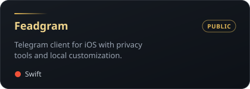
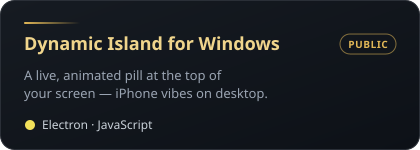
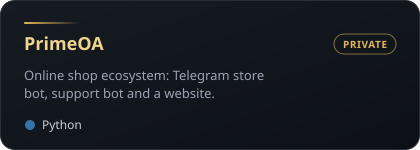
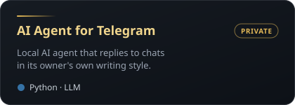
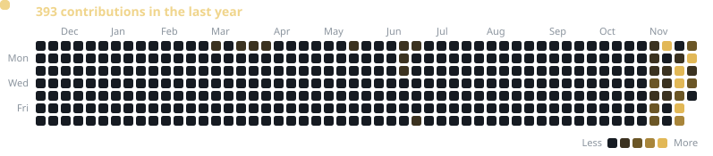

 

 

  

<h3 align="center">✦ Tech Stack ✦</h3>

  

  
  
  
  
  

<h3 align="center">✦ Featured Projects ✦</h3>

  
  
  
  

<h3 align="center">✦ Fun Corner ✦</h3>

  

<b>🎲 &nbsp;Random facts about me</b>

 

| | |
|:-:|:--|
| ☕ | My code compiles faster after the second coffee |
| 🌙 | The best bugs are found at 3 AM |
| 🤖 | I taught a bot to answer messages exactly like me |
| 🏝️ | My Windows has a Dynamic Island. Yes, really |
| 🔁 | If I do something twice, the third time it's a script |

 

  <picture>
    <source media="(prefers-color-scheme: dark)" srcset="https://raw.githubusercontent.com/malirty/malirty/output/snake-dark.svg"/>
    <source media="(prefers-color-scheme: light)" srcset="https://raw.githubusercontent.com/malirty/malirty/output/snake-light.svg"/>
    
  </picture>

